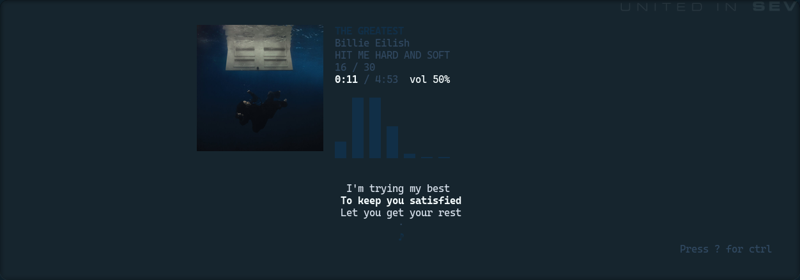
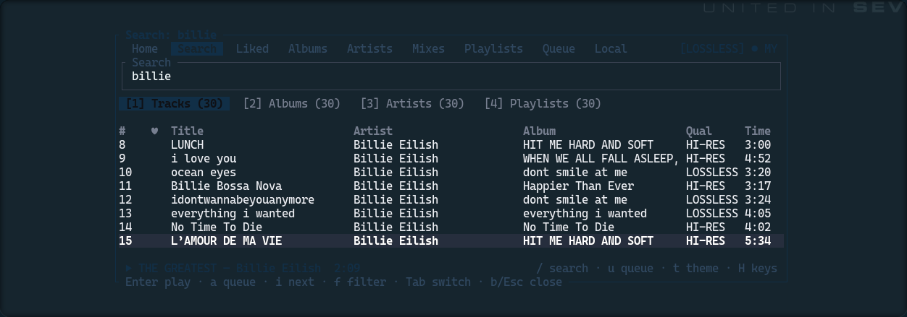

# tide

A minimalist, transparent Rust terminal music player for Tidal built with `ratatui`, `cpal`, `symphonia`, `ratatui-image`, and `souvlaki`.





## Features

- **Minimalist Transparent Now Playing Canvas**
  - Transparent terminal background so your terminal wallpaper and compositor blur show through.
  - Centered album art (`ratatui-image` Kitty / Sixel / Halfblocks or crisp Unicode Braille fallback) beside track metadata (title, artist, album, queue index, `♥` favorite, elapsed/total time, `vol %`, pause/buffer indicator) and a 10-bar flat-topped vertical block spectrum visualizer (`  `..`██`).
  - Centered multi-line synced lyrics fading toward the active line with a centered `♪` note below (and plain lyrics scrolling fallback).
  - Toggle a subtle controls border around the player card with `?`, or open the full shortcut reference modal with `H`.
- **Minimalist Browser & Queue Overlay**
  - Opens directly in the centered Browser overlay (`Home`, `Search`, `Liked`, `Albums`, `Artists`, `Mixes`, `Playlists`, `Queue`, `Local`, `Settings`) on launch; toggle anytime with `b` / `Tab`, press `/` or `Ctrl+F` to jump straight into Search, or `u` for the Play Queue drawer.
  - Selecting a track or pressing `b` / `Tab` / `Esc` transitions directly to the minimalist Now Playing view.
- **Tidal Browsing & Discovery**
  - Personalized **Home** feed sections (`Mixes`, `Albums`, `Playlists`, `Tracks`).
  - Unified **Search** across Tracks, Albums, Artists, and Playlists, plus instant in-list fuzzy filter (`f`).
  - Drill-down views for **Albums**, **Playlists**, **Mixes**, and **Artists** (Top Tracks, Albums, Related Artists) plus **Track Radio** (`r`).
  - Synced **Favorites** (`♥`) for tracks, albums, artists, and playlists (`m`).
- **Audiophile Playback, Queue & Offline Cache**
  - Quality selection (`LOW`, `HIGH`, `LOSSLESS`, `HI_RES_LOSSLESS`) with automatic step-down fallback.
  - Handles BTS streams (including `OLD_AES` decryption) and DASH MPD manifests (`<BaseURL>` and `<SegmentTemplate>`/`<SegmentTimeline>`), plus local FLAC / MP3 / M4A / OGG / WAV files.
  - Persistent disk audio cache (`~/.cache/tidal-tui/audio`) with range-aware progressive streaming & sample-accurate seeking.
  - Queue management: append (`a`), play next (`i`), reorder (`J`/`K`), remove (`x`), clear (`C`), shuffle (`s`), and repeat (`R`: Off / All / One).
  - Background **Download Queue** (`d`) to `~/Music/Tidal` with FLAC/M4A metadata & cover art embedding.
- **Theming & Desktop Integration**
  - Defaults to **Album Art** vibrant accent color extraction; cycle themes anytime with `t` (**Album Art** -> **Omarchy** `~/.local/state/omarchy/current/theme/colors.toml` -> **Pywal** `~/.cache/wal/colors.json` -> **Dark**).
  - Automatic session import (and token refresh) from `~/.config/tidal-tui/session.json`, `~/.config/lumitide/session.json`, `~/.config/tide/session.json`, and `~/.config/undertow/.../session.json`, plus non-blocking in-TUI OAuth device-code sign-in (`Ctrl+L`).
  - MPRIS media controls & hardware media keys (`souvlaki`).
  - Full Vim + arrow keyboard navigation and mouse support (click to select/play, scroll wheel volume/lists).
  - Live `cpal` audio output device picker and cache stats in **Settings**.

## Usage

```bash
tide
tide --search "Daft Punk"
tide --local
```

### CLI Options

- `-s`, `--search <QUERY>`: Start directly in the Search overlay with a Tidal query.
- `-l`, `--local`: Start directly in the Local Files overlay.
- `-h`, `--help`: Print help.
- `-V`, `--version`: Print version.

## Keybindings

| Key | Action |
|---|---|
| `?` | Toggle compact controls border around the Now Playing card |
| `H` | Open full Keyboard Shortcuts & Mouse Controls modal |
| `Space` | Play / Pause (or start playback on first cue) |
| `n` / `→` and `p` / `←` | Next / Previous track |
| `↑` / `↓` or `+` / `-` | Volume up / down (or mouse wheel on Now Playing canvas) |
| `.` / `,` | Seek +10s / -10s |
| `l` | Toggle centered Lyrics below player card |
| `j` / `k` | Scroll plain lyrics (or navigate lists inside overlay) |
| `/` or `Ctrl+F` | Open Search overlay focused on search input |
| `b` or `Tab` | Open / toggle Browser overlay (`Tab` / `Shift+Tab` cycles sections inside overlay) |
| `u` | Open Play Queue overlay |
| `Enter` | Play track (closes overlay) / Open Album, Artist, Playlist, or Mix / Switch device |
| `Backspace` / `Esc` | Go back / Close Browser overlay or modal |
| `f` | Fuzzy-filter current track list |
| `[` / `]` or `1`-`4` | Switch sub-tabs (Search / Artist / Home sections) |
| `s` / `R` | Toggle Shuffle / Cycle Repeat (Off / All / One) |
| `a` / `i` | Append track to queue / Insert as Play Next |
| `J` / `K` / `x` / `C` | (Queue tab) Move track down/up, remove track, clear queue |
| `r` | Start Track Radio from current or selected track |
| `m` | Toggle Favorite (`♥`) on Tidal |
| `d` | Download track / album / playlist in background |
| `t` | Cycle Theme (Album Art -> Omarchy -> Pywal -> Dark) |
| `Ctrl+L` | Sign in to Tidal via device code flow |
| `q` (Now Playing) / `Q` / `Ctrl+C` | Quit |

## Paths

- Config: `~/.config/tidal-tui/config.json`
- Session: `~/.config/tidal-tui/session.json`
- Audio Cache: `~/.cache/tidal-tui/audio`
- Downloads: `~/Music/Tidal` (configurable via `XDG_MUSIC_DIR` / config)

## Building

```bash
cargo test --offline
cargo build --release --offline
```
